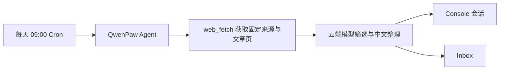

# 2026-10-10 AI 技术深度日报｜QwenPaw：每天 9 点的 AI 资讯 Agent 能否可靠工作？

> 今日研究原则：只深挖一个项目。今天没有把“安装成功”当成“自动化可用”，而是继续验证定时触发、网页抓取、云模型筛选和 Console 交付这条完整链路。

## 今日结论

- **今日项目**：[QwenPaw](https://github.com/agentscope-ai/QwenPaw)
- **所属方向**：Personal Agent / 自动化 / 信息聚合
- **核心问题**：在不下载本地大模型、使用隔离环境和云端模型的前提下，QwenPaw 能否每天早上 9 点整理过去 24 小时最值得关注的 10 条国内外 AI 资讯，并把结果保存到 Console？
- **一句话理解**：QwenPaw 把“定时器、会使用工具的 Agent、模型和消息收件箱”连在一起，让个人助理可以到点主动完成任务并交付结果。
- **我的判断**：**QwenPaw 的完整链路已经跑通，可以进入次日真实运行观察。** 免费云模型方案没有通过，但接入 DashScope `qwen3.7-plus` 后，任务能稳定完成固定来源抓取、逐页复核、中文整理并写入 Console/Inbox；正式 Cron 已启用，macOS 登录后台服务也已配置。
- **今天最重要的收获**：个人 Agent 的产品质量不等于“任务运行成功”。对于资讯任务，时间范围、来源真实性、链接完整性、重要性排序和稳定完成时间必须分别验收。

## 大白话解释

可以把 QwenPaw 想成一个带闹钟的私人助理系统：

1. Cron 是闹钟，负责每天 9 点叫醒助理。
2. `web_fetch` 是助理能用的取件工具，负责拿回新闻 RSS。
3. 云端大模型是编辑，负责判断哪些新闻重要、去重并写成中文。
4. Console 和 Inbox 是收件箱，负责保存最终简报。

今天确认的是：闹钟、取件工具、云端编辑和收件箱都能工作。免费编辑会把泛泛标题和低价值新闻混进 Top 10；换成 DashScope `qwen3.7-plus` 后，能够在限定抓取次数内完成正文复核并产出 9 条合格候选。随后又补上“精确文章链接、同一媒体最多 3 条、二手来源降级”的发布前规则。

## 为什么选择它

- **发现来源**：为了筛选能管理日常生活、主动提效的热门开源 Personal Agent，在候选中选择了 QwenPaw。
- **入选原因**：它同时具备云端模型接入、定时任务、工具调用、Console、Inbox 和本地自托管能力，能够直接检验“每天主动交付资讯”这个真实需求。
- **我原本想验证的问题**：不下载本地大模型时，能否只靠云模型完成每天 9 点的国内外 AI 资讯 Top 10？
- **为什么没有继续 VoiceStudio**：VoiceStudio 更适合验证声音克隆与语音生成，不直接解决每天主动搜集、筛选和交付信息的问题。

## 项目概览

- **GitHub 地址**：[agentscope-ai/QwenPaw](https://github.com/agentscope-ai/QwenPaw)
- **PyPI**：[qwenpaw](https://pypi.org/project/qwenpaw/)
- **项目定位（官方说明）**：可部署在本机或云端、可通过 Skills 和 Plugins 扩展、可连接多种渠道的个人 AI 助理。
- **本次安装版本**：QwenPaw 2.2.1。
- **Python 要求**：Python 3.11 至 3.13；本机原有 Python 3.9.6 不满足要求，因此使用 `uv` 单独安装 Python 3.11。
- **许可证**：Apache License 2.0。
- **目标用户**：希望自托管个人 Agent、定时自动化和多渠道助理的个人或团队。
- **本次只验证的能力**：云端模型、Console、工具调用、Cron、Inbox；没有验证长期记忆、外部聊天渠道、多 Agent 和本地模型。

## 它是怎么工作的

### 核心组件

1. **Cron 调度器**：保存任务、时区、超时时间、目标会话和交付方式；本次设置为 `0 9 * * *`、`Asia/Shanghai`。
2. **Agent 与工具治理**：模型决定何时调用工具，QwenPaw 记录和治理工具调用。本次禁用了 `execute_shell_command` 与 `web_search`，只保留固定来源和文章页抓取路径；过大的抓取结果会被保存为工作区临时文件，模型会用只读工具继续读取。
3. **云端模型提供方**：本次没有下载本地大模型；先后测试 Kilo 免费路由下的多个模型，最终接入 DashScope `qwen3.7-plus`。
4. **Console 与 Inbox**：Cron 最终结果可以投递到 Console 会话，并保存到 Inbox。
5. **会话上下文**：同一个 Cron 会话会积累历史。实验发现，反复测试如果沿用旧会话，旧的工具结果可能污染新一轮判断；最终验证改用了全新会话。

## 试用设计

### 实验假设

QwenPaw 2.2.1 可以在隔离环境中使用云端模型，在 10 分钟内完成固定来源抓取、最多筛选 10 条资讯、生成中文摘要，并把结果保存到 Console 和 Inbox。

### 成功标准

- 明确给出过去 24 小时的起止时间。
- 国内和国外资讯均有覆盖。
- 最多 10 条；不足时宁可少报，不能用旧闻或低质量内容凑数。
- 每条包含已确认事实、为什么值得关注、发布时间和完整链接。
- 不出现省略号链接、未来时间、窗口外旧闻或未抓取到的事实。
- 10 分钟内完成，结果进入 Console 和 Inbox。
- 不调用命令行或开放式网页搜索。

### 失败标准

- 运行超时或模型不可用。
- 事实、时间或链接不可复核。
- 把普通相关资讯当作“最重要 Top 10”。
- 大量违反工具、语言或输出格式要求。

### 试用环境

- **操作系统**：macOS。
- **使用端**：Codex + QwenPaw Console。
- **安装方式**：`uv tool install --python 3.11 qwenpaw==2.2.1`。
- **隔离环境**：`uv` 独立 tool 环境，不改动项目 Python 依赖。
- **模型方式**：DashScope `qwen3.7-plus`，不下载本地大模型。
- **Console 地址**：仅监听 `127.0.0.1:8088`。
- **遥测**：初始化时选择退出。
- **定时任务状态**：已启用；每天 09:00（`Asia/Shanghai`）执行，保存到 Console 和 Inbox。

## 实验结果

| 阶段 | 操作 | 实际现象 | 判断 |
| --- | --- | --- | --- |
| 隔离安装 | 用 `uv tool` 安装 QwenPaw 2.2.1 与 Python 3.11 | QwenPaw 环境约 1.0 GB，Python 运行时约 76 MB；没有下载本地模型 | 通过 |
| 启动 Console | 初始化后启动 `qwenpaw app` | Console 可在本机访问；空闲时进程 RSS 约 439 MiB | 通过 |
| 基础云模型 | Kilo Auto 生成中文并抓取测试网页 | 简单生成和 `web_fetch` 工具链可用 | 通过，但不代表复杂任务质量 |
| 第一版资讯任务 | 开放式 `web_search`，超时 900 秒 | Tavily 多次返回 429；Agent 又回退到未沙箱的 shell/curl，最后超时 | 失败；立即停用任务并禁用 shell、web_search |
| 固定来源任务 | Kilo Auto 只读取固定 RSS | 约 2 分钟完成并进入 Console/Inbox，但包含窗口外旧闻、未来日期、占位链接、英文输出和疑似未核实事件 | 技术通过，内容失败 |
| 明确大模型 | Nemotron 3 Ultra + 固定来源复核 | 10 分钟超时；实际抓取次数也超过提示词上限 | 失败 |
| 快速模型 | Step 3.7 Flash | QwenPaw 列表可选，但 Kilo 网关立即返回 `404 model_not_found` | 失败 |
| 轻量最终对照 | Nemotron 3 Super + 全新会话 + 4 个 RSS | 2 分 44 秒完成；10 条、国内外各 5 条、时间和链接完整，并保存到 Console | 技术通过，选题质量未通过 |
| DashScope 首测 | `qwen3.7-plus` + 4 个 RSS | 原 30 秒流式空闲上限导致长推理中断；调到 120 秒后不再报错 | 定位并修复运行参数 |
| DashScope 严格 RSS | 4 个 RSS + 逐条正文复核 | 10 个 Google News 重定向链接正文均不可读，模型按规则输出 0 条 | 规则诚实，但来源设计失败 |
| DashScope 多来源 | 国内聚合/媒体 + 海外媒体栏目 + 官方 RSS | 4 分 52 秒完成；9 条、正文验证 9 条、18 次抓取封顶，并写入 Console/Inbox | 核心质量通过；发现一条精确链接缺失和媒体集中问题 |
| 发布前加固 | 增加精确文章链接、同一媒体最多 3 条、二手来源最多 2 条等硬规则 | 已写入正式任务；未再额外消耗一次完整模型测试 | 待下一次 09:00 实跑确认 |
| 后台运行 | macOS 用户级 LaunchAgent 启动 QwenPaw | 服务状态 `running`，本机健康检查返回 `status: ok`，保留 120 秒流式等待参数 | 通过 |

### 最终对照为什么仍不合格

Nemotron 3 Super 的最终结果比前几轮可靠，但仍把标题仅为 “Artificial Intelligence” 的泛化条目、医疗资讯汇总中的一小段 AI 内容、地方座谈会等选入“最重要的 10 条”。它还遗漏了提示词要求的行业信号总结。说明免费模型可以机械地满足数量、时间和链接格式，却不能稳定完成“重要性判断”这一核心编辑工作。

### DashScope 为什么可以进入真实运行观察

`qwen3.7-plus` 能在 18 次 `web_fetch` 上限内先读 8 个固定入口，再打开 10 个候选文章页复核；最终没有为了凑数强行输出 10 条，而是给出 9 条，并明确说明国内高分候选不足。它也能区分事实与分析、给出评分和北京时间。仍发现一条只指向栏目首页的国内候选，以及结果偏向 The Verge 的问题，因此正式版又增加了精确文章链接和媒体数量上限。这个最终规则版本要以 10 月 12 日 09:00 的真实运行结果作为最后确认。

### 资源占用

- **磁盘**：本次实际新增约 1.08 GB，而不是 10 GB。
- **内存**：QwenPaw 服务空闲时约 439 MiB RSS；这是运行内存，不包含浏览器和其他系统进程。
- **本地模型**：0 个，没有产生数 GB 至数十 GB 的模型权重下载。
- **云端代价**：DashScope 会产生 API 调用费用；本次没有取得可靠的单次 token 账单，因此不能给出准确金额。

## 遇到的问题与排查过程

### 问题一：任务能跑，但内容不可信

- **现象**：结果出现窗口外旧闻、未来日期、省略号链接和未被来源支持的公司动作。
- **最初判断**：可能只是提示词不够严格。
- **实际结果**：收紧为固定来源、完整链接和逐条自检后，格式改善，但“最重要”的筛选仍然不稳定，说明模型能力和路由质量也是瓶颈。
- **处理**：任务保持停用，不用错误结果换取“自动化已完成”的表面成功。

### 问题二：开放式搜索触发限流和不安全回退

- **现象**：Tavily 返回 429 后，Agent 尝试使用 shell/curl；日志明确显示 shell 在当前配置下未启用沙箱。
- **风险**：即使 Cron 开启 `tool_safety`，模型仍可能选择其他已注册工具。
- **处理**：在默认 Agent 中禁用 `execute_shell_command` 和 `web_search`，任务改为固定 RSS；后续构建日志中的工具数量从 25 降到 23。

### 问题三：免费模型清单与实际网关不一致

- **现象**：Step 3.7 Flash 在 QwenPaw 模型列表中存在，实际调用却返回 404。
- **判断**：本地静态模型列表不能替代真实 API 可用性测试。

### 问题四：旧会话会污染重复实验

- **现象**：同一 Cron 会话积累了前几轮工具结果，模型后来读取了旧临时文件。
- **处理**：最终对照改用全新目标会话 `ai_daily_news_0900_v2`；实验任务不共享用户会话。
- **产品启发**：周期性资讯任务应按次隔离上下文，或者只保留结构化历史摘要，不能无限复用调试会话。

### 问题五：长 RSS 推理触发 30 秒流式空闲超时

- **现象**：DashScope 密钥和模型均已加载，但模型读取 4 个长 RSS 后，QwenPaw 报告连续 30 秒没有内容片段并中止。
- **判断**：不是 API Key 无效，而是 QwenPaw 的默认流式空闲等待太短。
- **处理**：按本机安装文档将 `QWENPAW_LLM_STREAM_IDLE_TIMEOUT` 调为 120 秒；重启后同类长推理不再中断。

### 问题六：抓取器不接受部分标准 RSS 类型

- **现象**：TechCrunch 和 Ars Technica 的 RSS 返回 `application/rss+xml`，QwenPaw `web_fetch` 判定为不支持；Google News RSS 虽可读取，但文章链接是重定向，无法复核正文。
- **处理**：海外来源改用可读取的媒体栏目页，再从栏目页提取精确文章链接；Google News 只允许有限的 RSS 级验证。
- **产品启发**：资讯 Agent 需要“来源健康检查”和降级策略，不能假设所有 RSS 都能被同一个抓取器解析。

### 问题七：模型会夸大证据等级

- **现象**：模型曾把 AIBase 转载写成“与纽约时报原文一致”，或把栏目页摘要算作第二个正文验证来源。
- **处理**：正式规则要求来源质量只按实际读取 URL 计分；二手来源最高 1 分；只有两个精确文章 URL 都被单独抓取且返回正文，才能写“双来源验证”。

## 我真正学到了什么

### 技术层面

- QwenPaw 的 Cron 不只是定时发送固定文本，它可以在指定时区触发一个带工具的 Agent，并将最终结果交付到 Console 与 Inbox。
- `tool_safety=true` 不等于所有工具天然安全；真正的权限边界还取决于 Agent 已启用的工具和运行环境。高风险工具应从配置层禁用，而不是只靠提示词要求模型“不要用”。
- 云模型列表中的“可选”不代表网关当前“可调用”，必须做真实请求验证。
- 资讯 Agent 最难的部分不是抓到新闻，而是时间过滤、来源核验、去重、重要性排序和异常处理。

### 产品层面

- **它创造的价值**：如果质量过关，用户每天打开 Console 就能直接看到已筛选的 AI 行业简报，节省浏览和初筛时间。
- **真正影响体验的指标**：准时完成率、24 小时时间命中率、有效链接率、重复率、事实错误率、Top 10 重要性以及端到端耗时。
- **必须解释的异常**：来源不足、抓取失败、模型超时、合格条目少于 10 条、模型不可用、任务未在后台运行。
- **如果由我设计**：把“抓取与时间过滤”放进确定性代码，将清洗后的结构化候选交给模型只做排序和中文解释；再增加链接检查、日期校验和结果发布前的规则验收。单靠一个长提示词让模型同时抓取、解析、核验和排序，稳定性不足。

## 局限与风险

- **次日真实调度尚未观察**：手动触发和后台健康检查都通过，但最终规则版本尚未经历一次真实的 09:00 调度；下一次计划运行时间为 2026-10-12 09:00（北京时间）。
- **本机运行限制**：QwenPaw 已注册为 macOS 用户级登录服务，但电脑关机、注销或长时间睡眠时不能保证恰好在 09:00 执行。任务设置了 12 小时补跑宽限，实际睡眠恢复后的补跑行为仍待验证；要保证云端准点运行，需要迁移到持续在线的服务器。
- **云端隐私**：提示词和抓取到的资讯内容会发送给云模型提供方；不应把个人隐私或公司内部信息混入任务。
- **密钥管理**：DashScope API Key 由用户在本地 Console 输入，没有粘贴到对话或日报；尚未验证 QwenPaw 对本地密钥的加密方式。
- **模型成本**：DashScope 为正式云模型，本次尚未取得单次任务的准确 token 和费用账单。
- **来源偏差**：即使增加媒体数量上限，固定来源仍可能遗漏当天的重要独家报道；模型的重要性评分也不是事实校验器。

## 我的最终判断

> QwenPaw 确实解决了“让个人 Agent 定时主动工作并把结果送到固定收件箱”的真实问题。本次已经证明隔离安装、DashScope 云模型、受限工具调用、Cron、Console、Inbox 和 macOS 后台服务可以连成一条可运行链路，而且不需要下载本地大模型。免费 Kilo 模型没有达到发布标准，`qwen3.7-plus` 达到了进入真实运行观察的水平。正式任务现已启用；是否长期保留，要看 10 月 12 日 09:00 的首轮自动结果是否继续满足精确链接、来源分散和证据等级要求。

## 下一步实验

- [x] 用户在本地 Console 配置 DashScope API Key，不在聊天中传递密钥。
- [x] 使用 `qwen3.7-plus` 完成多轮手动验收；最佳一轮 4 分 52 秒产出 9 条、正文验证 9 条。
- [x] 启用每天 09:00 的 Cron，结果写入 Console 和 Inbox。
- [x] 配置 macOS 用户级 LaunchAgent，并通过本机健康检查。
- [ ] 观察 2026-10-12 09:00 的首次真实自动交付；若有栏目首页链接、同一媒体超过 3 条或证据等级夸大，立即暂停并修正规则。
- [ ] 从 DashScope 控制台核对单次调用 token 与费用。
- [ ] 是否进入本周周报：是；原因是它暴露了“Agent 框架成功”和“业务结果可信”之间的关键差距。

## 我的学习复述

QwenPaw 解决了自动化获取国内外 AI 资讯的问题，能够每天 9 点触发自动任务。它的核心链路是：通过 `web_fetch` 获取固定来源和文章页面，再由云端模型进行筛选和中文整理，形成总结内容。今天最终验证了隔离安装、DashScope 模型调用、受限网页抓取、中文整理、Console/Inbox 保存以及 macOS 后台运行这条链路；最终规则版本仍需通过 2026-10-12 09:00 的首次真实调度确认长期稳定性。

## 资料来源

- [QwenPaw GitHub 仓库](https://github.com/agentscope-ai/QwenPaw)（核查日期：2026-10-10）
- [QwenPaw PyPI 页面](https://pypi.org/project/qwenpaw/)（核查日期：2026-10-10）
- 本机 QwenPaw 2.2.1 Console、Cron 状态、模型调用日志与 Inbox 输出（实验日期：2026-10-10 至 2026-10-11）
